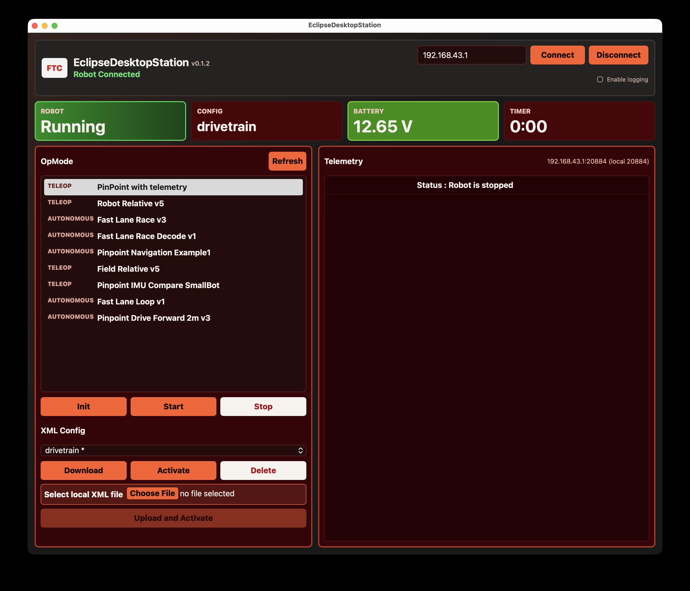

# EclipseDesktopStation

Virtual Driver Hub app similar to REV's.

This is a Tauri + Rust app that connects to a Robot Controller over the FTC
Robocol UDP protocol. Targets FTC SDK 12.0 (Robocol version 124). Intended for
practice and diagnostics — **not for official competition use**.



## Features

- Connect to a Robot Controller by IP address.
- Heartbeat/keepalive traffic to maintain the Robocol session.
- OpMode list with Init, Start, and Stop lifecycle controls (Utility
  OpModes from SDK 11.2+ are listed last, with their description on hover).
- Robot state, battery, active config, and practice timer.
- Telemetry display (preserves packet order; shows unnamed rows).
- Detects when another Driver Station is already connected and greys out.
- Surfaces robot errors and toasts (OpMode uncaught exceptions, etc.).
- XML config management:
  - Browse and select configs from a dropdown (active config marked `*`).
  - Download a config to `~/Downloads`.
  - Activate any config on the hub, restart the robot runtime to apply its hardware map, and wait until the runtime is ready.
  - Upload a local XML file (activates on save — RC behavior).
  - Delete configs.
- USB gamepad control, sent to the robot exactly like the SDK 12.0 Driver
  Station (gamepad1/gamepad2, same dead zones and stick directions):
  - Logitech F310 (either switch position), Xbox 360 controllers, PS4/PS5
    controllers, and other gamepads your OS recognizes. On macOS the F310 in
    **X** mode and wired Xbox 360 controllers are read over raw USB, since macOS
    has no driver for them.
  - The first controller is assigned to gamepad1 automatically and a second one to
    gamepad2. Reassign from the Gamepads bar, or hold **Start** and press **A**
    (gamepad1) or **B** (gamepad2), as on the Driver Hub.
- JSONL session logs (opt-in) for field debugging — disabled by default,
  enabled via a checkbox by the IP box.

## Local automation interface

External tools can query robot status, connect, and initialize/start/stop registered
OpModes through the app’s private Unix socket, using the same connection as the GUI.
See the [automation API and integration guide](docs/AUTOMATION.md).

## Download

Pre-built installers for macOS, Linux, and Windows are on the
[Releases](../../releases) page. Download the file for your OS and run it —
no Rust or Node.js required.

> **macOS note:** The app is not yet notarized. On first launch, right-click
> the app and choose **Open** to bypass Gatekeeper.

## Development

### Requirements

- Node.js + npm
- Rust toolchain (`rustup`)
- Linux: `libudev-dev` (gamepad support).
- Tauri 2 system dependencies for your OS
  ([see Tauri docs](https://v2.tauri.app/start/prerequisites/))

### Run locally

```bash
npm install
npm run tauri:dev
```

### Common checks

```bash
npm run build
cd src-tauri && cargo check
cd src-tauri && cargo fmt
cd src-tauri && cargo run --example gamepad_check   # live USB gamepad readout
```

### Build a release binary

```bash
npm run tauri:build
```

Artifacts land in `src-tauri/target/release/bundle/`.

### Regenerate icons (if you change `icon_source.png`)

```bash
npx @tauri-apps/cli icon src-tauri/icons/icon_source.png
```

## Project Layout

```
src/
  main.js          — frontend UI and Tauri command calls (vanilla JS)
  styles.css       — FTC Driver Station-inspired dark layout
src-tauri/
  src/
    lib.rs         — Tauri command surface and app state
    robocol.rs     — UDP Robocol client: packets, heartbeat, telemetry, commands
    xml_config.rs  — XML validation and Downloads save path
    debug_log.rs   — per-session JSONL logging (non-fatal, OS log dir)
  icons/
    icon_source.png — 1024px source icon (regenerate set with tauri icon)
  tauri.conf.json
```

## Debug Logs

Session logging is **disabled by default** — no files are written until you
tick the **Enable logging** checkbox next to the IP address box. While enabled,
each session is written to:

| OS      | Path |
|---------|------|
| macOS   | `~/Library/Logs/EclipseDesktopStation/session-<ts>.jsonl` |
| Linux   | `~/.local/state/EclipseDesktopStation/logs/session-<ts>.jsonl` |
| Windows | `%LOCALAPPDATA%\EclipseDesktopStation\logs\session-<ts>.jsonl` |

The active log path is shown in the app's top bar while logging is on. Logging
is best-effort — the app runs normally even if the log directory cannot be
created.

Key event names: `connect`, `disconnect`, `tx_command`, `rx_command`,
`rx_telemetry`, `robot_stacktrace`, `robot_toast`, `peer_discovery`,
`save_config_xml`, `activate_config`, `delete_config`.

## Protocol Notes

- Robocol UDP port: `20884`
- Robocol version: `124` (unchanged from FTC SDK 11.x through 12.0)
- Peer discovery advertises SDK `12.0`, build month `2026-09`
- Default Control Hub IP: `192.168.43.1`
- If local port 20884 is in use, the app falls back to an ephemeral port
  (shown in the telemetry panel header).

## Known Limitations

- macOS releases are not notarized (no Apple Developer account required to
  build, but first-run requires right-click → Open).
- Linux uses the system WebKit2GTK runtime. The `.AppImage` bundles most of
  what's needed; `.deb` installs the dependency via apt.
- Windows and Linux runtime behavior is CI-tested but not yet live-tested
  against a physical Control Hub.

## License

MIT — see [LICENSE](LICENSE).

Configuration activation and XML upload both restart the robot runtime. Completion requires a fresh runtime state transition back to Running and refreshed active configuration, OpMode list, and configuration list; a matching configuration name alone does not count as success. INIT and START are rejected while a configuration change is in progress. Restart and metadata timeouts are reported as errors, since the selected configuration may not yet have been applied to hardware. The SDK does not provide an explicit SAVE result; when overwriting an already-active configuration, selection confirmation cannot independently prove that the file was written.
